<picture>
  <source media="(prefers-color-scheme: dark)" srcset="https://raw.githubusercontent.com/HarshThumar/HarshThumar/main/assets/header-dark.svg">
  <source media="(prefers-color-scheme: light)" srcset="https://raw.githubusercontent.com/HarshThumar/HarshThumar/main/assets/header-light.svg">
  
</picture>

  
  
  

**Building and breaking authorization for AI agents.** I ship production LLM and data systems in Indian fintech, and I formally model how MCP agents get their credentials.

---

### Now: a formal model of MCP authorization

[**mcp-auth-tamarin**](https://github.com/HarshThumar/mcp-auth-tamarin)  is my IETF 127 Hackathon project (remote).

- **The question:** can an untrusted MCP server get an agent to send its credentials to the wrong authorization server?
- **Model 01:** the model rediscovers a published, already-fixed MCP SDK advisory on its own ([GHSA-qx49-fqc8-xw99](https://github.com/modelcontextprotocol/python-sdk/security/advisories/GHSA-qx49-fqc8-xw99)). With the bug, Tamarin finds the attack. With the fix, the property is proven. CI checks it on every push.
- **Next:** PKCE, RFC 8707 audiences and RFC 9207 issuer checks, then CIMD and ID-JAG enterprise token exchange.
- **Community:** remote participant in the IETF **OAuth** and **WIMSE** working groups; following the AAIF Identity & Trust WG.

### How I build AI that touches money

<picture>
  <source media="(prefers-color-scheme: dark)" srcset="https://raw.githubusercontent.com/HarshThumar/HarshThumar/main/assets/rule-dark.svg">
  <source media="(prefers-color-scheme: light)" srcset="https://raw.githubusercontent.com/HarshThumar/HarshThumar/main/assets/rule-light.svg">
  
</picture>

### Production work

> [!NOTE]
> This is employer and client work, so the code is private. I'm happy to walk through any of the designs.

| What I built | How it's kept safe and correct |
|---|---|
| 🏦 **Credit-appraisal API for lenders.** Takes bank-statement, GST and bureau data plus the lender's own policy PDF, runs 30+ forensic checks, then an LLM drafts the memo with every finding cited to its source clause or cell. | Postgres row-level security per tenant · AES-256-GCM field encryption with blind indexes · hash-chained audit log · LLM pinned to an India region · 585 tests |
| 🤖 **LLM analyst with a guarded SQL tool.** 12 domain tools plus a read-only SQL tool. Every number in an answer must come from a tool result. | sqlglot allows a single SELECT only · 25-table allow-list · read-only DB role · statement timeout · per-user token quotas · 30-question eval suite |
| 📊 **Mutual-fund data platform** (main engineer). Covers 55 fund houses and 10+ years: 7.7M holdings rows, 8.6M NAV rows and 64K source documents, each with recorded provenance. | 7 quality gates per fund house · p95 latency **27.5 s → 1.5 s**, **9×** throughput · keyless CI/CD (Workload Identity Federation) |
| 🧾 **Underwriting app for borrowers with informal income.** 46 business-type income methods, rebuilt from a lender's Excel workbooks. | Golden tests against the workbook figures · every number traces back to its source cell · rules recommend, a credit manager signs off · guard that refuses to store personal data |

<b>More production work</b>

 

- **Compliant content engine.** Writes financial posts in 4 Indian languages from a fact pack. A deterministic checker blocks any number that isn't in the source, a versioned rule engine checks the text and then an LLM reviews it. Has a spend cap and an audit trail.
- **Multi-agent application evaluator** (built end to end as the sole engineer). CrewAI agents draft a rubric for a human to approve, then retrieve from applicants' documents to score each one with a justification per criterion. Runs on Cloud Run and Cloud Tasks with LangSmith tracing.
- **Document AI for project finance.** Extracts facts from PDF, DOCX and XLSX deal documents, reconciles conflicts between them, and drafts memoranda in which every citation points to a bounding box in the source.
- **Real-time computer-vision edge box (team project).** I helped label data for and train the detection model. I built the camera setup and pitch calibration, scoring and the post-match flow, highlights, analytics and the live-broadcast overlay. I also containerized the GPU deployment, and found a container setting that was silently forcing inference onto the CPU.
- **Infrastructure.** Terraform for GCP: Cloud Run, private Cloud SQL, Secret Manager, Cloud Tasks, monitoring and Workload Identity Federation. Also a cloud-agnostic backend template (AWS / Azure / GCP) with MFA, scoped JWTs and field encryption built in.

### Open source and side projects

| | |
|---|---|
| 🧠 [**zero-cost-gaia-agent**](https://github.com/HarshThumar/zero-cost-gaia-agent) | A LangGraph research agent that scored **90% (18/20) on GAIA Level 1** with **$0** spent on models. It repairs malformed tool calls and takes a majority vote over 3 runs |
| 🧾 [**BillExtraction**](https://github.com/HarshThumar/BillExtraction) | Turns invoice PDFs into Google Sheets rows (Docling + FastAPI on Cloud Run), with keyless service-account impersonation |
| 🏏 [**Ground booking marketplace**](https://booking-sable-iota.vercel.app) | Next.js, Supabase and Razorpay. A row-locked Postgres function makes double booking impossible, and Gemini handles natural-language search |
| ☕ [**Café**](https://komo-by-kaffa-self.vercel.app) and [**café**](https://pepito-bice-beta.vercel.app) **sites** | Unsolicited spec designs: scroll-driven 3D sites built with Astro, GSAP and three.js, with AI menu photography. Lighthouse scores 100 for accessibility, best practices and SEO |

### Tools

<picture>
  <source media="(prefers-color-scheme: dark)" srcset="https://skillicons.dev/icons?i=python,ts,fastapi,react,nextjs,postgres,redis,gcp,firebase,terraform,docker,githubactions,linux&theme=dark&perline=13">
  <source media="(prefers-color-scheme: light)" srcset="https://skillicons.dev/icons?i=python,ts,fastapi,react,nextjs,postgres,redis,gcp,firebase,terraform,docker,githubactions,linux&theme=light&perline=13">
  
</picture>

Also: LangGraph · CrewAI · Vertex AI / Gemini · Docling · Tamarin prover · OAuth 2.1 / OIDC

If you work on agent authorization, MCP security or OAuth for agents, I'd like to hear from you.
